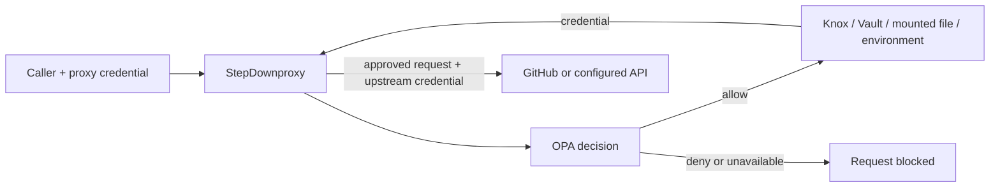

# StepDownproxy

**Keep the credential. Delegate the operation.**

An MIT-licensed, self-hosted HTTP gateway that holds your upstream API credentials, checks each request with Open Policy Agent, and injects the credential only after approval. Give an assistant, script, or teammate a separate proxy credential that can perform precisely the operations your policy permits.

For example: keep a GitHub token in Pinterest Knox, allow a caller to read issues in one repository, and deny deletion, access to other repositories, and unapproved writes.



StepDownproxy limits access **through the gateway**. It does not mint a new provider token or modify the original token's permissions. A holder of the original token can still use its original permissions directly.

## What works today

- Named, fixed upstream origins with per-service credential references and injection headers.
- Per-caller authentication; OPA sees the authenticated identity, method, canonical path, parsed query, selected headers, and JSON body.
- Default deny and fail closed when policy or secret storage is unavailable.
- Pinterest Knox v0 Primary-version retrieval, including custom CAs and client certificates.
- HashiCorp Vault KV v2, mounted files/Docker secrets, and environment variables.
- Optional management console: service asset editing, persistent configuration, policy simulation, and recent audit metadata.
- Non-root Docker images and a local demo with OPA and a mock GitHub API.
- A standalone companion, [knox-management](https://github.com/quentinmayo/knox-management), for Knox key inventory, provisioning, versions, rotation, and ACLs.

## Try it in Docker

Requires Docker Compose and Python 3. The demo creates random fake credentials; no real GitHub or Knox account is needed.

```sh
git clone https://github.com/quentinmayo/StepDownproxy.git
cd StepDownproxy
python3 scripts/init-demo.py
docker compose up --build -d
python3 scripts/smoke.py
```

The proxy listens at `http://127.0.0.1:18080`. Its optional console is at `http://127.0.0.1:19090`. To sign in locally, obtain `STEPDOWN_ADMIN_TOKEN` from the generated, ignored `.env` file. The browser keeps the credential in memory until refresh/lock; it uses no persistent browser storage.

Make a scoped request:

```sh
set -a
. ./.env
set +a
curl -H "Authorization: Bearer $STEPDOWN_CLIENT_TOKEN" \
  http://127.0.0.1:18080/proxy/github/repos/example/project/issues
```

The mock API reports `token_injected: true`. A `DELETE` to the same path returns `403`; another repository is denied. The demo uses plain HTTP on an isolated Docker network and publishes only loopback ports. Its console state is held in a tmpfs and disappears when the container is recreated.

```sh
docker compose down
```

## Configure a real service

Start with [examples/github/config.json](examples/github/config.json) and replace the example origins, secret locations, and Rego identities/repositories. Configuration contains references rather than credential values.

```json
{
  "id": "github",
  "url": "https://api.github.com",
  "credential": {"provider": "knox", "ref": "stepdown:github:token"},
  "header": "Authorization",
  "prefix": "Bearer "
}
```

Supported credential references:

| Provider | Reference | Notes |
| --- | --- | --- |
| `knox` | `stepdown:github:token` | Reads the current Primary; requires `knox` backend configuration. |
| `vault` | `secret/data/github` plus `field: "token"` | Exact KV v2 API path, relative to `/v1/`; requires `vault` backend configuration. |
| `file` | `/run/secrets/github-token` | Re-read after every approved request; mount read-only. |
| `env` | `GITHUB_TOKEN` | Read from the process environment. |

Backend authorization credentials must reference `env` or `file`. Vault and Knox credentials are retrieved after approval and are not cached between requests. Client credentials are hashed at startup and require restart to change. Each client token must have at least 32 bytes and be unique. Keep caller, admin, secret-store, and upstream credentials distinct.

Knox authentication is the **complete Knox authorization string**, such as `0u` followed by a user credential or `0t` followed by the machine identity used with mTLS. The gateway preserves the prefix and verifies the server certificate. Grant its Knox principal only Read access to the required keys. See [Knox integration](docs/KNOX.md).

For Vault, define a backend with `url`, a local `token` reference, and optional `ca_file`, `cert_file`, `key_file`. Use a narrowly scoped Vault policy such as read access to `secret/data/github`. AWS KMS/Secrets Manager and other providers are future work.

## Run from source

Requires Go 1.27 or newer.

```sh
go build -o bin/stepdownproxy ./cmd/stepdownproxy
bin/stepdownproxy -config /path/to/config.json -check
bin/stepdownproxy -config /path/to/config.json
```

Enable management explicitly:

```sh
bin/stepdownproxy -config /path/to/config.json \
  -admin-listen 127.0.0.1:9090 \
  -admin-token-file /run/secrets/stepdown-admin \
  -state /var/lib/stepdown/assets.json
```

Without `-admin-token-file`, management reads `STEPDOWN_ADMIN_TOKEN`. The state directory must exist and be writable by the service user. Asset updates are validated, written with mode `0600`, and atomically applied. On restart the saved service list takes precedence over the base config. Policy, clients, and backend connections remain controlled by the base config and policy deployment. Management does not edit OPA policies remotely.

Use `-tls-cert` and `-tls-key` to enable HTTPS on both listeners, or place the listeners behind a correctly configured TLS reverse proxy. Do not expose a cleartext credential-bearing listener to untrusted networks. The example uses separate data and admin ports. The project can sit behind Envoy; an Envoy `ext_authz` service is not implemented in this release.

## Policy contract

The configured OPA URL must be a `/v1/data/` decision returning a JSON **boolean** `result`. Undefined, non-boolean, failed, and timed-out responses block the request. See [OPA's API](https://www.openpolicyagent.org/docs/rest-api).

```json
{
  "input": {
    "principal": "demo-reader",
    "service": "github",
    "method": "GET",
    "path": "/repos/example/project/issues",
    "query": {"state": ["open"]},
    "headers": {"accept": ["application/vnd.github+json"]},
    "body": null
  }
}
```

The caller cannot set `principal` through a header. Query values are arrays so repeated parameters remain visible. Only approved application headers reach the upstream; authorization, cookies, forwarding headers, and method-override headers are excluded. Authorization is added separately after the decision. The sample policy allows one read route and demonstrates a body-constrained write rule for an otherwise unconfigured identity.

## Boundaries of this first release

This is an initial implementation, not an independently audited security boundary. Review the [threat model](docs/THREAT_MODEL.md) before deploying it with valuable credentials.

HTTP JSON APIs are the target. Request bodies are limited to 1 MiB, buffered responses to 8 MiB. Encoded/ambiguous paths, dot segments, repeated slashes, credential-like query parameters, compressed bodies, and duplicate JSON keys are rejected. This deliberately excludes some API paths, file uploads, GraphQL semantic authorization, streaming, WebSockets, and CONNECT tunneling. Do not grant GraphQL or generic RPC endpoints using only a path/method rule.

All redirects are blocked. Response cookies and authorization headers are omitted. Exact plaintext echoes of the injected or caller credential in permitted response fields are blocked; a malicious upstream could encode or transform a credential, so configure only trusted origins. OPA receives request bodies and queries: protect its network, storage, and own logging settings.

The management console is a single-operator privileged interface. It has a separate credential, same-origin checks, a restrictive CSP, and no third-party assets. Multi-user SSO, administrative RBAC, durable audit storage, rate limiting, automatic backend login/lease renewal, and cloud KMS are on the roadmap.

## Development and validation

```sh
go test -race -cover ./...
go vet ./...
docker run --rm -v "$PWD/policies:/policies:ro" \
  openpolicyagent/opa:1.21.2-static test /policies -v
```

CI also builds the Docker image, runs the demo smoke tests, checks Go vulnerabilities, and scans Git history with Gitleaks. The companion's integration suite exercises the real Pinterest Knox router, encrypted in-memory storage, ACL enforcement, and rotation through a running StepDownproxy binary. See [validation](docs/VALIDATION.md) and [contributing](CONTRIBUTING.md).

## License

[MIT](LICENSE). Pinterest Knox and OPA are separate projects with their own licenses. StepDownproxy is independent and is not endorsed by Pinterest, HashiCorp, Envoy, or GitHub.
